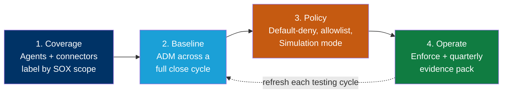
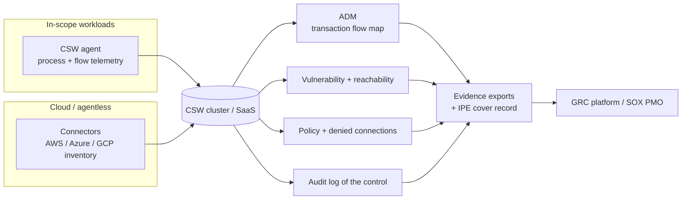

# Cisco Secure Workload — SOX IT General Controls Reference Design


> A step-by-step blueprint for building **Cisco Secure Workload (CSW)** so a public company can restrict network access to its **financially-relevant systems** and produce the **machine-generated evidence** a SOX tester or external auditor will accept — a defensible scope boundary, a live transaction flow map, operating-effectiveness evidence across the full fiscal period, change drift, and audit-ready exports.

**SOX is a statute, not a control catalogue.** The Sarbanes-Oxley Act requires management to assess internal control over financial reporting (**§404(a)**) and, for accelerated filers, requires the external auditor to attest to it (**§404(b)**). Neither the Act nor the SEC publishes controls to implement. Companies satisfy SOX by selecting frameworks — **COSO 2013** at the entity level, **COBIT 2019** for IT general controls — and designing controls that support the assertions in their financial statements.

So this repo maps CSW to the **four conventional ITGC domains** every SOX programme and audit firm uses, cross-referenced to COBIT 2019 and **PCAOB AS 2201**. It invents no SOX control identifiers, because none exist.

---

## Read this before anything else — the scope boundary

CSW is an IT general control over **logical access at the network layer**, plus a monitoring and evidence source. It is never a SOX control by itself. The control is your organisation's restriction of access to financially-relevant systems; CSW implements part of that restriction and produces the artefacts proving it operated.

| ITGC domain | CSW contribution |
|---|---|
| **APD** — Access to Programs and Data | **Substantial**, for the network-path portion only |
| **CO** — Computer Operations | **Moderate** — monitoring, availability signals, incident reconstruction |
| **PC** — Program Changes | **Detective only** — drift detection, not change authorisation |
| **PD** — Program Development | **None** |

| CSW does **not** | Who owns it |
|---|---|
| User access review, entitlement recertification, leaver removal | IAM / PAM / application |
| Authentication and MFA | Identity provider |
| Segregation of duties inside the financial application | The financial application |
| Application-layer authorisation — "who may post a journal entry" | The financial application |
| Change authorisation workflow | ITSM |
| Program development and SDLC | Engineering / PMO |
| Backup, recovery, and job-failure handling | IT operations |
| Management review controls and entity-level COSO controls | Finance / SOX PMO |
| Financial reporting logic, reconciliations, journal entry controls | Finance |
| Controls library, test plans, deficiency workflow | GRC platform |
| Attestation | Management and the external auditor |

Three points worth stating plainly to a customer:

1. **Most of the APD domain is identity, not network.** Entitlement review and recertification are the bulk of what a SOX tester samples under "access to programs and data." **CSW consumes identity from Active Directory, Entra ID, and Cisco ISE — it is not the identity system.** Claiming the domain outright is the fastest way to lose an auditor's confidence.
2. **Enforcement is L3/L4**, with connection detail through L5. Any control that depends on *what a user did inside the application* is out of reach.
3. **CSW exports used as audit evidence become IPE** — Information Produced by the Entity — and must be shown complete and accurate. Budget for the integrity controls in [§11.2](CSW-SOX-Reference-Design.md) from the first testing cycle, not after a tester rejects an undated CSV.

---

## What's in this repo

| Document | For | Use it to |
|---|---|---|
| **Reference Design** — [MD](CSW-SOX-Reference-Design.md) · [PDF](CSW-SOX-Reference-Design.pdf) · [DOCX](CSW-SOX-Reference-Design.docx) · [HTML](CSW-SOX-Reference-Design.html) | SE / platform / security engineering | Build CSW end-to-end: scope architecture keyed on the SOX boundary, close-cycle ADM, enforcement, per-objective evidence |
| **[Evidence Checklist](docs/evidence-checklist.md)** | Evidence owner | A printable "what to export, from where, how often" worklist with IPE cover records |
| **[POV / Workshop Plan](docs/pov-plan.md)** | SE + customer | Run a scoped ~70-day proof-of-value on one financial reporting boundary |

---

## How CSW produces evidence — the big picture



Each phase produces a specific, exportable artefact. The **[Reference Design](CSW-SOX-Reference-Design.md)** maps every artefact to an ITGC control objective.

---

## The scope tree that does the work

Most CSW scope trees are keyed on application or environment. For SOX, key the **first level on the audit boundary** from your scoping memo, and keep a deliberate out-of-scope sibling.

```
SOX-Relevant
├── Financial-Reporting-Core     ERP / general ledger, consolidation and close
├── Feeder-Systems               order-to-cash, procure-to-pay, payroll, treasury
├── Supporting-Infrastructure    database, batch and scheduling, managed file transfer, identity
└── Admin-Access                 jump hosts, privileged tooling

Non-SOX-Adjacent                 everything else — retained on purpose
```

> **The `Non-SOX-Adjacent` → `Financial-Reporting-Core` deny is the single most valuable policy in this design.** The most persuasive segmentation evidence in a SOX audit is not what in-scope systems talk to — it is proof that out-of-scope systems **cannot reach** the financial reporting core. A deny rule with a Denied Connections record behind it is the clearest boundary evidence available, and the one most organisations can currently only assert on paper.

---

## The close cycle governs your baseline

**This is the most important operational point in the whole design, and the most common way a SOX deployment fails.**

A financial estate does not look the same mid-month as it does at close. Consolidation jobs, inter-company interfaces, revaluation batches, statutory extracts, and reconciliation tooling may run **once a month or once a quarter**. A two-week ADM window taken mid-month misses them entirely, and the resulting policy blocks the close.

Baseline across **at least one complete month-end**, preferably a **quarter-end**, before authoring policy. Where a year-end-only process exists, document it as a known exception with a named owner rather than discovering it in December.

This is why Phase 2 here runs 30–45 days rather than the 14 days used in most frameworks in the library.

---

## Reference architecture at a glance



---

## Coverage snapshot

CSW provides **🟢 Direct** evidence for **8** ITGC control objectives, **🟠 Supporting** input for **2**, and marks **⚪ Evidence Required** *(supplied outside CSW)* for **10** further areas. The full mapping is in [§7 of the Reference Design](CSW-SOX-Reference-Design.md).

**Coverage key**

- 🟢 **Direct** — CSW produces the **primary evidence** artefact for the objective.
- 🟠 **Supporting** — CSW produces an **input that feeds or complements** another control's evidence.
- ⚪ **Evidence Required** *(supplied outside CSW)* — CSW produces **nothing** here. The area is **in scope for SOX but out of scope for CSW**; the customer supplies the evidence through **another control, tool, or process**. This marks a **boundary, not a gap or a failure.**

> Coverage describes what evidence CSW produces — **not** that a control objective is satisfied, and ⚪ never means an objective is unsupported.

### Where the Direct evidence lands

| ITGC objective | What CSW gives you |
|---|---|
| **APD** — network access to in-scope systems is restricted | Enforced allowlist plus Denied Connections for the full period |
| **APD** — administrative access paths are restricted | Source-locked admin-port rules; flow records of paths actually used |
| **APD** — production and non-production are segregated | Scope-to-scope deny with a denied-flow record proving it held |
| **APD** — the in-scope population is complete and accurate | Inventory reconciled to the scoping memo, with an exception list |
| **PC** — change to the access control itself is traceable | Policy version history with checksums; Administration audit log |
| **CO** — scheduled jobs and interfaces execute as documented | Flow and process telemetry on batch and file-transfer tiers across a close |
| **CO** — monitoring detects events affecting in-scope systems | Alert history; agent availability report; SIEM forwarding samples |
| **CO** — incidents can be investigated and reconstructed | Forensic flow and process search with parent/child context |

### Why this matters more for SOX than for most frameworks

SOX ITGC testing has historically relied on point-in-time samples — a firewall rule screenshot, a quarterly access list. Those show a control **existed** on one date. §404 asks whether it **operated effectively throughout the period**.

That gap is where CSW is strongest. Denied Connections across the fiscal period, with a negative test showing an attempted connection blocked and logged, is the single most persuasive artefact in this design. Continuous evidence also supports a **roll-forward** from interim testing to year-end, and a **benchmarking** argument for the automated element — though accepting benchmarking is the external auditor's judgement to make, not yours to assert.

---

## Disclaimer

This reference design is **informational reference only** — not legal, audit, accounting, or completeness advice. SOX has **no official control catalogue**; the ITGC domains and control-objective wording here are conventional industry structure and must be aligned to your own control library, your SOX PMO, and your external auditor before use. It requires **SME review** against current PCAOB and SEC sources. Cisco Secure Workload does not confer SOX compliance and is not an attestation.
