# SOX ITGC — CSW POV / Workshop Plan

A ~70-day proof-of-value that stands up CSW evidence on **one** financial reporting boundary. The goal is a repeatable quarterly evidence pack and internal-audit confidence — not an estate-wide rollout.

> Scope one financially-relevant application and its supporting infrastructure. Instrumenting the whole in-scope estate during a POV is the most common way POVs stall — and in a SOX environment it also drags the change-control burden forward before anyone has seen value.

**Why 70 days and not 45.** Every other framework in this library can baseline in two weeks. SOX cannot. The ADM window has to span a **full month-end close**, ideally a quarter-end, or the resulting policy will block the close. Build the calendar backwards from the close date before you agree a start date.

```mermaid
gantt
    dateFormat  X
    axisFormat  Day %s
    section Coverage
    Instrument + label by SOX scope        :a1, 0, 10
    section Baseline
    ADM across a full close cycle          :a2, 10, 35
    Owner + internal audit signoff         :a3, 45, 5
    section Policy
    Author + Simulation across a close     :a4, 46, 24
    section Operate
    Enforce (post-close) + quarterly pack  :a5, 70, 7
```

---

## Prerequisites

- The current **SOX scoping memo**: significant accounts, in-scope business cycles, and the financially-relevant application list.
- The **fiscal calendar**, with month-end, quarter-end, and year-end close windows marked. Agree the baseline window against it before anything else.
- A named contact in **internal audit or the SOX PMO** — not only IT. The boundary is theirs to confirm, and the evidence is being built for them.
- Agreement on **which ITGC control objectives CSW evidence will be attached to**, secured *before* building. Evidence designed to the test is accepted; evidence designed first and mapped later gets challenged.
- Agreement on **IPE integrity requirements** for exports.
- The change-management process for the enforcement step, and confirmation of whether enabling enforcement is itself a change requiring assessment.
- Last cycle's ITGC findings, so exports line up with what was already asked for.

> Agree up front whether the POV touches production financially-relevant systems or a non-production equivalent. Many organisations will require the first pass in non-production — which is workable for Phases 1 and 2 but produces weaker evidence, since the close-cycle flows are the point.

---

## Phase 1 — Coverage (Days 1–10)

**Goal:** every workload in the chosen boundary visible in CSW, labelled against the scoping memo.

| Day | Activity | Output |
|---|---|---|
| 1–2 | Boundary workshop with the SOX PMO and application owner. Pick one application plus its database, batch, and file-transfer dependencies | Agreed POV scope, written down |
| 3–6 | Agent deployment in **Monitoring Only**. Cloud connectors where agents are not viable | Agents active, telemetry flowing |
| 7–8 | Label design and application: `sox_scope`, `sox_cycle`, `financial_app`, `fiscal_relevance`, `itgc_domain`, `app_owner`, `env` | Label scheme applied |
| 9–10 | Scope tree built, including the `Non-SOX-Adjacent` sibling. Reconcile inventory to the scoping memo | Inventory reconciliation + exception list |

**Checkpoint.** Walk the reconciliation with the SOX PMO. Expect three categories of difference: hosts that should be in scope and were missed by the memo, hosts in the memo that no longer exist, and genuine coverage gaps. The first two are scoping corrections worth raising now; the third goes to the deficiency tracker.

> This checkpoint frequently delivers more value than anything else in the POV. Most organisations cannot currently produce a defended in-scope population.

---

## Phase 2 — Baseline (Days 11–45)

**Goal:** a machine-generated flow map of the financial reporting system, covering a full close.

| Day | Activity | Output |
|---|---|---|
| 11 | ADM workspace started on the POV scope, process context enabled | ADM running |
| 11–45 | Observation across a complete month-end close | Flow and process telemetry |
| ~close | Close-window review session while the batch and interface flows are fresh | Annotated close-cycle flow list |
| 40–45 | Undeclared interfaces documented and raised to the SOX PMO | Scoping questions log |
| 45–50 | Application and process owners sign the cluster-to-application mapping | Signed mapping |

**Checkpoint.** Present the ADM map alongside whatever architecture diagram the organisation currently uses for the walkthrough. The delta between the two is the demonstration — PCAOB AS 2201 expects the auditor to understand the flow of transactions, and a live map does that better than a diagram last updated two reorganisations ago.

> Raise undeclared interfaces early and in writing. A reporting tool pulling straight from the general ledger database may widen the audit boundary, and discovering it during external audit fieldwork is materially worse than discovering it here.

---

## Phase 3 — Policy (Days 46–70)

**Goal:** a designed, owner-approved ruleset proven in simulation, ready to enforce.

| Day | Activity | Output |
|---|---|---|
| 46–50 | Author policy from ADM. Boundary deny first, then production/non-production, then admin source-locking, then the allowlist | Draft policy |
| 50–52 | Review with application owners; refine | Owner-reviewed ruleset |
| 52–70 | **Simulation across a close window.** Resolve false positives through change tickets | Simulation report |
| 68–70 | Exception register finalised; enforcement change record raised | Approved change record |

**Checkpoint.** The simulation report is the deliverable here, and it is also the change-board evidence. It shows what *would* have been blocked without blocking anything — which is the reassurance a change-control audience needs before a financially-relevant system goes behind enforcement.

---

## Phase 4 — Operate (Day 70 onward)

**Goal:** enforcement live, and a quarterly pack that survives a tester.

| Activity | Output |
|---|---|
| Enforce **outside a close window**, rationale documented | Enforcement live |
| Negative test — attempt a connection that should fail | Denied Connections record |
| Controlled rollback test, performed once | Rollback evidence |
| Assemble the first quarterly pack with IPE cover records | Evidence binder |
| Verify SIEM forwarding | Sample events |

**Checkpoint.** Hand the first quarterly pack to internal audit and ask them to test it as if it were fieldwork. Their objections now are free; the same objections in March are not.

---

## What success looks like

Judge the POV on these, in this order:

1. **A defended in-scope population.** Inventory reconciled to the scoping memo, with exceptions named and owned.
2. **A live transaction flow map** covering a full close, signed by application owners.
3. **A boundary deny that holds**, with a Denied Connections record proving out-of-scope systems cannot reach the financial reporting core.
4. **One quarterly evidence pack** with IPE cover records, reviewed by internal audit and accepted.
5. **A written list of the ⚪ boundaries** naming which control and tool owns each one.

Item 5 matters more than it looks. A POV that ends with an honest boundary list is trusted; one that implies CSW covered the whole APD domain gets unpicked at the first audit.

---

## What this POV deliberately does not attempt

- User entitlement review, recertification, or any identity control
- Segregation of duties inside the financial application
- Change authorisation workflow — CSW detects drift, ITSM authorises
- Program development or SDLC controls
- Backup and recovery testing
- Any assertion that the organisation is SOX compliant, which is management's to make and the external auditor's to attest

---

## Common ways this POV goes wrong

| Risk | Mitigation |
|---|---|
| Baseline window misses the close | Build the calendar backwards from the close date. This is the single biggest risk |
| Enforcement introduced during close | Schedule the Phase 3 → 4 transition post-close and document why |
| IT-only stakeholder set | Insist on a named internal audit or SOX PMO contact from day one |
| Evidence designed before the control objectives are agreed | Secure the objective mapping in prerequisites, not at the end |
| Exports with no IPE cover record | Apply the cover record from the first export |
| Scope creeps to the whole in-scope estate | One application plus dependencies. Expand after the first accepted pack |
| CSW positioned as covering "access to programs and data" | Say "the network-path portion of APD" every time |
